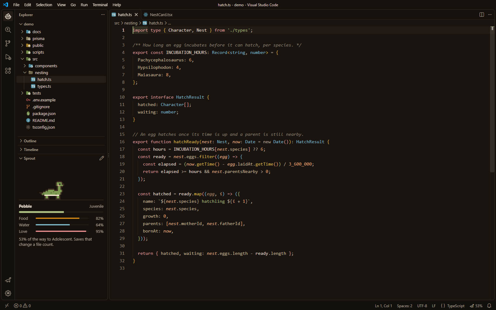
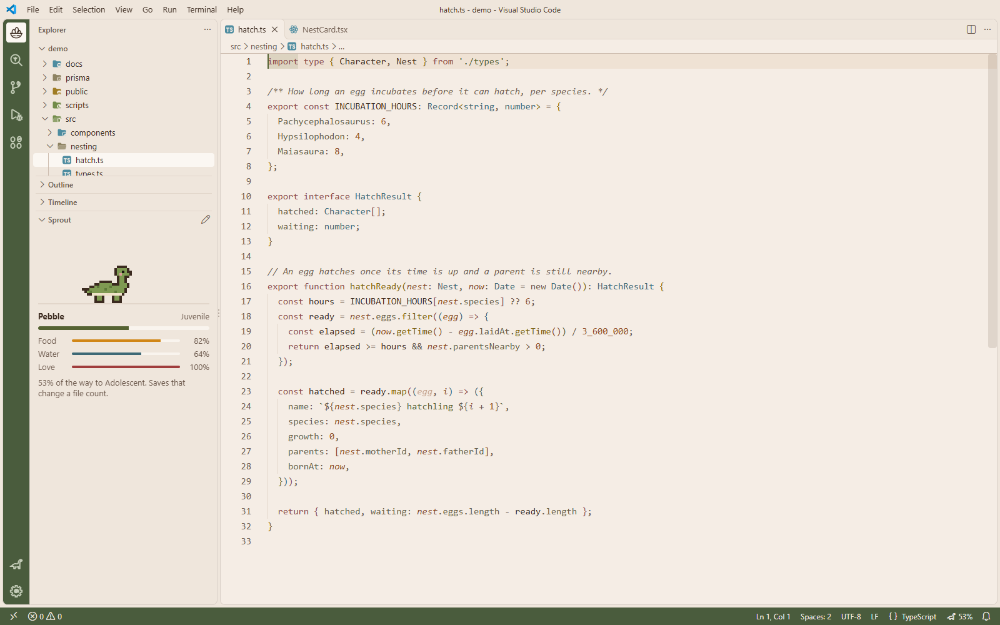
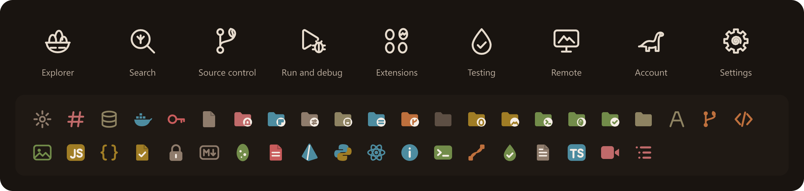
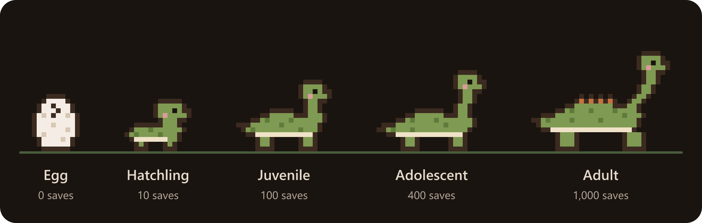
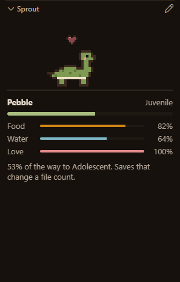

# Rosa Wildlife Reserve for VS Code

Warm colors, hand-drawn icons and a small dinosaur for your editor, from
[Rosa Wildlife Reserve](https://rosarealism.com), a Path of Titans realism
server.



## What's inside

- **Rosa Dark** and **Rosa Light**: dark brown and cream, with green, amber
  and rose accents. Every text color reaches at least 4.5:1 contrast.
- **Rosa Product Icons**: the activity bar drawn for the Reserve. A nest of
  eggs for your files, a fern branch for source control, an amber drop for
  tests and a sauropod for your account.
- **Rosa File Icons**: 54 file and folder icons that read on both themes.
- **Your sprout**: a pixel sauropod in the Explorer that hatches and grows as
  you work.



## Set it up

1. Install the extension and reload the window.
2. Run **Preferences: Color Theme** and pick **Rosa Dark** or **Rosa Light**.
3. Run **Preferences: File Icon Theme** and pick **Rosa File Icons**.
4. Run **Preferences: Product Icon Theme** and pick **Rosa Product Icons**.
5. Open **Sprout** at the bottom of the Explorer to meet your egg.

Each part works on its own, so you can keep the colors and use other icons,
or the other way around.



## Your sprout

Your sprout starts as an egg and grows through five stages. A save counts
when it changed the file, and one file counts at most once a minute, so
holding Ctrl+S doesn't rush it.





| Stage | Saves |
|---|---|
| Egg | 0 |
| Hatchling | 10 |
| Juvenile | 100 |
| Adolescent | 400 |
| Adult | 1,000 |

The egg rocks from the start, cracks as it gets close, and breaks open when it
hatches. Once it's out, your sprout gets hungry and thirsty:

- **Food** empties over 12 hours. Every save that counts fills a bit of it.
- **Water** empties over 8 hours. Clearing every error in your code fills most
  of it.
- **Love** empties over a day. Click your sprout to give it a pet: a little
  heart floats up and love fills a bit. A well-loved sprout sends hearts on
  its own.
- Below 20% food or water, your sprout sits down and the status bar says so.
  Below 20% love, it asks for a pet. It never dies and never loses growth.

It naps after five minutes without typing or saving, and walks slower while
your code has errors. Its growth and needs show in
the status bar, and VS Code keeps them across windows and restarts.

| Command | What it does |
|---|---|
| **Rosa: Show my sprout** | Opens the Sprout view. |
| **Rosa: Rename my sprout** | Gives it a new name. You can also click its name. |
| **Rosa: Start over with a new egg** | Sets its growth back to zero. You can't undo this. |

| Setting | Default | What it does |
|---|---|---|
| `rosa.sprout.enabled` | `true` | Shows your sprout and lets it grow. |
| `rosa.sprout.statusBar` | `true` | Shows its growth in the status bar. |

## Troubleshooting

**Rosa Light shows dark backgrounds.** An extension such as Vibrancy
Continued has written dark backgrounds into `workbench.colorCustomizations`
in your settings, and those win over every theme. Add a block for the Rosa
theme in the same setting, which wins over the general keys:

```jsonc
"workbench.colorCustomizations": {
  // the keys the other extension wrote stay here
  "[Rosa Light]": {
    "editor.background": "#f5ede5",
    "editorPane.background": "#f5ede5",
    "sideBar.background": "#efe6dc",
    "activityBar.background": "#4a5c3d",
    "panel.background": "#efe6dc",
    "terminal.background": "#efe6dc"
  }
}
```

Cover every key the other extension set. Keep Rosa Light opaque: cream over
dark glass turns gray and makes the comments hard to read.

**Another extension's status bar item shows letters.** Some extensions draw
their status bar picture with their own product icon theme. With Rosa Product
Icons active, that picture shows as plain letters. Switch that extension's
item off, or use its product icons instead.

## Build it yourself

```bash
npm install
npm run package
code --install-extension rosa-theme-1.3.0.vsix
```

Edit the sources, never the generated files, then run `npm run build`:

| What | Source | Writes |
|---|---|---|
| Theme colors | the palettes in `build.mjs` | `themes/` |
| File icons | the drawings in `build-file-icons.mjs` | `icons/files/`, `file-icons.json` |
| Product icons | the line drawings in `icons/product/` | `fonts/rosa-icons.woff`, `product-icons.json`, `icon.png` |
| The sprout | `extension.js`, `media/` | nothing, it runs as is |

Each build stops when a color drops under its contrast minimum.
`npm run screenshots` retakes the pictures in `images/` from a real VS Code
window with its own profile, so your setup is never touched.

## License

MIT. See [LICENSE](LICENSE).
